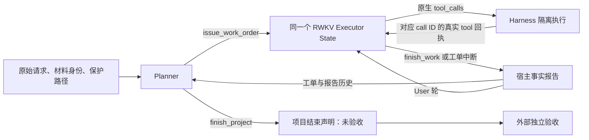

# 当前编码项目架构

产品只有一条 Project 执行链：Planner 按工单循环派发，RWKV Executor 在一个持续 State 中自主读取文件、选择工具、实现、自测、修复和交回。工单粒度决定单次交回前的自主范围；放大粒度或更换模型须另做受控验收，不能自动复用原结果或 State。

当前 RWKV 没有视觉能力。浏览器操作、截图和视觉验收由 Codex 或独立验收器在执行链外完成。宿主报告、模型结束声明和外部验收分别记录；工程检查不产生 Agent 能力结论。

## 工单循环与持续 State

Planner 只有 `issue_work_order` 和 `finish_project` 两个动作。工单 schema 直接来自 `project_work_orders.order_schema()`，字段固定为 `protocol/id/goal/scope/checks/call_budget`。Planner 收到原始请求、初始工作区身份、明确引用材料的 SHA/字节数/状态、保护路径、实际工具能力、已发工单及对应宿主报告、剩余预算；不收到完整文件正文。文件内容由 Executor 自行读取。

项目创建时捕获请求明确引用的材料，核对捕获前后的工作区与逐文件身份；完整原件保留在账本，模型输入仅引用其身份。Trace 重建使用冻结上下文，不重读后来变化的源文件。未引用材料、间接引用与私有验收不会被自动注入。初始材料捕获不是针对任意外部写者的原子文件系统快照。

项目自创建起使用一个稳定 assignment 和 Executor lane。新工单、预算披露、协议拒绝事实及宿主报告作为 User 轮追加到同一 transcript；工单切换不重新委派、不换 lane、不清空 State。Native 请求只追加已确认历史之后的新消息。拒绝或输出截断的候选 State 回滚到干净父边界，保留原始输出和拒绝原因；截断候选不执行工具。恢复校验消息前缀、模型、权重、tokenizer、协议、工具、采样与 Native State 身份，不能用旧状态冒充新部署。

宿主按账本事实生成报告，包含检查命令实际退出码、stderr 末尾、实际提交的变更路径、调用用量及中断原因，并绑定 `report_digest`。只认本工单中已确认、在工作区根执行且字面完全匹配的前台检查命令。宿主不自动执行 `checks`、不调用模型、不判断正确性、不改写模型声明；报告不是完成门。

## 唯一协议与模块

CLI、批量任务和 Web 统一进入 `project_agent.run_project_job()`，恢复使用 `resume_project()`。`CodingJob` 保存原始请求、目录、总调用与墙钟预算、保护路径、生成快照选项，以及显式的连续无变更和拒绝上限。产品 scope 只有 `coding`；旧 files/inspect 路径拒绝运行。

|职责|当前实现|边界|
|---|---|---|
|工单与事实报告|`project_work_orders.py`|固定工单字段；报告只投影已确认事实|
|原目标与路径合同|`project_contracts.py`|原始请求、保护路径、稳定 assignment 和身份|
|Planner 输入|`project_protocols/planner.py::build_input`|每轮派单或结束声明；材料只给身份|
|Executor 输入|`project_protocols/executor.py::build_input`|同一原生 transcript 和当前工单|
|工具词表|`transcript/tools.py`|固定九工具；唯一规范名与底层参数映射|
|消息、回执与解码|`transcript/render.py`、`parse.py`、`grammar.py`|生产、trace、token 化共享真实消息形状|
|完整 token 与监督|`transcript/tokenize.py`、`frozen.py`|无损 token/mask；核验已封存来源，不生成数据|
|实际传输|`project_sessions.py`、`strong_transport.py`|Planner 原始 provider 回执；Executor Native State 增量|
|Planner 配置|`project_planner_settings.py`|只包含实际使用的传输、模型与预算配置|
|持久记录|`project_ledger.py`、`project_record_store.py`|单写者事务、事件链、内容寻址、原始事实与 pending|
|运行器|`project_runtime.py`|工单循环、权限、工具事务与中断；不做在线验收|
|工具实现|`harness.py`、`project_tools.py`、`background_jobs.py`|同一 schema 驱动执行、能力与解码|
|外部预览与检查|`project_launch.py`、`project_browser.py`|隔离启动与浏览器证据；不进入 RWKV 工具菜单|

Planner 输入/chat、Executor 输入/actions、assignment、ledger 和 architecture 当前为 `rwkv-lh.coder.*.v2`。工单为 `rwkv-lh.coder.work-order.v1`，transcript 为 `rwkv-lh.coder.transcript.v1`；这些独立版本以各模块常量为准，attestation 不硬编码版本。旧版和未知版协议、账本、数据及不兼容 State 拒绝加载或改标签重用。

旧五角色链、独立 exact_tool_selector、一次性初始计划协议、cc-view 实验实现及相应入口已退出生产；不保留兼容路由。irwkv 和 State Router 动态插件继续维护，不能仅因静态不可达而删除。后端或模型变化不重写角色协议。

## 原生 assistant transcript 与九工具

Executor 返回原生 assistant 消息：`role/content/reasoning_content/tool_calls`。每个调用有唯一 `id`、`type=function`、`function.name` 和 JSON 字符串 `function.arguments`；思考位于 `reasoning_content`，不使用 think 标签。一轮可包含多个工具调用，整批先验证，再按顺序执行；`finish_work` 必须最后出现。所有工具参数来自同一冻结 schema，宿主不补语义字段、不修复转义、不接受底层旧工具拼写或未知字段。

|规范名|作用|
|---|---|
|`Read`|按字节范围读取文件|
|`Write`|写入文件|
|`Edit`|按精确文本匹配替换|
|`Bash`|执行命令，可显式选择后台运行|
|`ListDir`|枚举目录|
|`Grep`|有界搜索与分页|
|`BashOutput`|读取后台作业新增 stdout/stderr|
|`KillShell`|停止本项目后台作业并报告观测结果|
|`finish_work`|以 finished 或 blocked 声明交回当前工单|

工具回执是对应原始 `tool_call_id` 的 tool 轮，content 为结构化 JSON，保留 `action_type/success/output/metadata/outcome_type` 等实际存在的字段。`finish_work` 的对应回执仅携带 `declaration` 原始参数。文件正文、命令输出和错误保持原文；渲染器仅去除宿主记账和重复元数据，不推断正确性、存活或完成。完整原始回执另存供身份核验。宿主报告只能作为 User 轮，不能伪造一个模型未发起调用的 tool 回执。

约束解码由 irwkv 内置 guidance 执行，grammar 从相同工具 schema 派生，保留 `additionalProperties:false` 和目标渲染键序。完整消息结构、跨轮 call ID 唯一性和工具参数仍由宿主校验。真实来源的 parse/render 逐字节往返只证明编解码一致；已有七工具轨迹可用于该项工程验证，不能当作当前九工具训练来源。

## 权限、后台作业与恢复

工作区是经身份核对的源目录副本。工单 `scope` 为字面写入路径集合，空数组只读；叠加 owner 保护路径。`file` 与 `./file`、`.` 与 `./` 按相同 POSIX 路径身份比较，保留原始拼写，不猜路径、不展开通配符。绝对路径、`..` 分量、反斜杠与 NUL 拒绝。

前台工具在隔离副本执行。显式越权写入在执行前拒绝；执行后的整体变化越权则全部不发布。合法变化经身份核对后按事务发布，失败和无变化各自保留真实回执，不伪造 mutation。相对符号链接必须逐段留在工作区，最终目标存在且无循环；原始链接拼写与实际文件 SHA 均进入身份。链接不扩大权限，保护路径也保护真实目标及中间链接。无效链接与特殊节点不发布。

`Bash` 使用共享宿主网络下载依赖和访问服务；它不是域名白名单。文件、PID 和其他命名空间继续隔离，只继承明确基础环境和普通 HTTP/HTTPS 代理，宿主凭据与用户 npm 配置不自动继承。网络外部效果不能由文件事务回滚，未知结果不能重放。

后台模式保留独立沙箱、私有工作区和独立日志目录，返回项目内 job handle。活跃期间异步文件变化不发布；`BashOutput` 或 `KillShell` 确认作业停止后，克隆稳定树并复核启动基线、当前与启动工单范围及保护路径，才可发布授权变更。前台已改变工作区时拒绝覆盖，记录冲突。`BashOutput` 按游标读取增量输出，`KillShell` 按进程身份终止；运行器退出时（包括 checkpoint yield）确认回收全部所属作业，丢弃尚未提交的私有变化，将停止事实追加到持续 transcript。日志出现 ready 不证明后续存活，作业自行退出按实际退出码报告。沙箱 namespace init 是否消失是清理判据；不能确认清理时抛出 `UncertainToolOutcome`，保留 pending 和私有目录，不降级为普通失败或假成功。

模型和工具先登记 intent，再确认返回。SQLite 事件链、内容寻址记录和原始回执保存输入、输出、checkpoint 与因果身份；已确认写入和已确认批次前缀不重复执行。失联、取消、发布或清理结果不确定时保留 pending；恢复不自动重放未知操作，也不在服务丢失必需 Native State 后假装恢复。

RecordStore 以 64 MiB 字节预算复用已校验节点；可变展开结果不共享，新读取事务重新校验，事件链检查仍覆盖完整历史。该缓存不限制完整返回历史或进程总内存，也不改变存储格式和模型输入。

## 终止、报告与计量

|边界|原因|处理|
|---|---|---|
|工单|`model_finished`|保存 `finish_work` 原始声明与事实报告，交回 Planner|
|工单|`call_budget_exhausted`|保存工单调用预算中断报告，交回 Planner|
|工单|`model_output_budget_exhausted`|截断候选不执行，交回 Planner|
|工单|`repeated_rejection`|达到显式拒绝上限，带原文和错误交回|
|项目|`planner_finished`|Planner 结束声明，尚未验收|
|项目|`resource_budget_exhausted`、`wall_budget_exhausted`|总调用或墙钟预算中断|
|项目|`model_input_budget_exhausted`|保存完整输入和容量证据，不截断|
|项目|`planner_protocol_error`|Planner 协议失败，不自动修补或重规划|
|项目|`uncertain_operation`|保留 pending，拒绝自动重放|
|项目|`no_progress`|达到显式连续零提交变更工单上限，按中断记录|

工单数量按任务需要，不另加数量拦截或静默截断。`CodingJob.no_progress_limit` 和 `rejection_limit` 默认均为 3，属于明示的工程停止边界，不能冒充模型完成。Planner 和 Executor 调用都计入项目总预算。

`RESULT.json` 分别记录 `planner_usage` 与 `executor_usage`：模型调用数、预留调用数、生成耗时、输入/输出 token 和有真实 token 计量的调用数。Planner token 来自本次原始 provider envelope 的 `prompt_tokens/completion_tokens`；缺少真实 usage 的调用不以估算代替，总量显示未知。容量估算另用于拒绝超长输入。没有计划模型独自完成的同口径对照，不能宣称省 token。

`status=finished` 与 `model_finished=true` 仅表示 Planner 选择结束；当前运行始终 `completed=false`、`acceptance=not_evaluated`。`finish_work` 只交回工单，CLI 退出码 0 对应 `planner_finished`，均不证明功能验收。mutation 只统计真实工具回执中的已提交变更。

执行目录保留 `project.sqlite3`、实际传输 trace、`raw_tools/`、`PROGRESS.jsonl`、`RESULT.json`，外层保存 `DELIVERY.json`；启用选项后保存 `generation_snapshots/`。Web 显示工单目标、scope、checks、calls、报告、当前工单及真实工具记录。轮询和文件预览按项目选择身份及请求游标隔离，过期响应不能覆盖当前视图。

## 外部验收

外部静态或 npm 预览在隔离副本启动。npm 项目使用声明的 dev 或 build/preview 脚本；生产预览要求 `dist/index.html`，不要求指定框架。预览不调用模型，也不改变本次完成声明。

独立浏览器检查使用新 Chromium 上下文和只读工作区，按合同保存逐动作状态、DOM/布局、截图、HAR、trace、console/pageerror 与网络事实。独立验证器保存完整 stdout/stderr、退出状态和证据 SHA；超时或中断保留不完整证据，不宣称通过。证据清单绑定工作区树、快照实现、验收输入、验证器源码及每份证据的字节数/SHA。私有程序和证据目录不暴露给候选进程，验收结果不送回 Executor State 或授予训练资格。

任务冻结时分开定义 Agent 的开发交付职责和外部浏览器/视觉要求，保留来源版本、许可证、资源、依赖、数据流、检查规则和任务族隔离。完整参考实现与私有验收放在允许材料之外。旧成绩和冻结口径不原地改写；Strict、completed、mutation 和终止原因先于角色或工程检查汇报。截图存在不证明视觉要求通过。

## 训练、推理与来源身份

训练统一使用固定版本 skyrl-rwkv 原生 `skyrl.train.main_sft`，全参数 SFT 为 `model.lora.rank=0`。本仓库只核验冻结模型、tokenizer、数据、源码、明确授权、预算和 GPU 身份，并向原生训练器交接；优化器、跨块梯度、checkpoint、恢复和模型导出均归 SkyRL。

训练 reader 只接受 `dataset.format=transcript_tokens` 和当前 `rwkv-lh.transcript-token-manifest.v1`。manifest 绑定模型/tokenizer、协议源码、生成脚本、生产来源清单、切分文件、owner 授权和 split/similarity/coverage 审计。逐来源核对当前九工具与原生 transcript，逐行复核完整 `input_ids` 和同长度 `loss_mask` 与共享 codec 一致；返回原行，不生成、转换、重标或补齐数据。旧 episode 格式直接拒绝。

每个消息轮次按与 Native 增量相同的渲染编码；assistant token 监督为 1，system/user/tool 为 0，被 mask 的 token 仍在原位置提供上下文。mask 不位移，不添加 BOS/EOS，不静默截断；容量不足直接拒绝。交接配置 `max_length=null`，chunk_size 来自登记；完整 split 文件 SHA 和行数核对完成后才发布 token store。新数据版本和训练预算必须由 owner 明确授权，本轮接线与清理不新增授权，也不采集或转换旧轨迹。

训练使用 BF16 权重/计算，递归 State 中 wkv 为 FP32、两个 token-shift 池为 BF16。推理统一使用 irwkv 的 `irwkv-native` profile，同样为 BF16 权重/计算、wkv FP32、两个 token-shift 池 BF16。两种运行分别登记实际精度与资源，不能笼统写作 State FP32。版本固定在 `skyrl.lock.json` 和 `inference/irwkv.lock.json`；训练、推理各用隔离的 Python 3.12+ 环境。

irwkv 负责模型、FlashRWKV2、调度、原生采样与 guidance；项目插件负责跨请求 State、事务、请求日志和身份。单卡部署 TP/PP=1、max_num_seqs=1，关闭 prefix caching，mamba_cache_mode=none。State 恢复核对 resident weights、布局、pending token、采样请求以及 engine/project 源码清单；不匹配即拒绝。服务绑定 loopback，远程通过隧道或受控代理访问，加载 `rwkv_lh_state_worker,rwkv_lh_native`。

模型是标准 Transformers-RWKV safetensors，包含完整 tokenizer、模板和生成配置。工件转换核对 checkpoint/转换器/模板/词表 SHA，重开所有 tensor 核对名称、形状、dtype、逐元素值及全部 token ID 字节。SkyRL export 封装保留导出权重字节，核对 PREPARED/RESULT 与实际更新证据，不凭退出码推断训练次数。服务器禁用 Git，上传完整文件清单、逐文件 SHA 和清单 SHA；实际加载来源不一致则拒绝运行。

训练登记 `rwkv-lh.skyrl-sft-run.v1` 绑定 experiment、authorization_references、sft_full 方法、模型/数据/源码 SHA、context、解释器、GPU 编号/UUID、batch、学习率、seed、epochs/max_steps、chunk/checkpoint 与显式恢复配置。部署登记 `rwkv-lh.irwkv-deployment.v1` 绑定 engine/project 源码、模型、解释器、GPU 编号/UUID、executor 协议、容量、端口和显存比例。默认只准备，新输出目录内显式 `--execute` 才启动；选卡前实查空闲，不占用别人的任务。

## 维护与发布

开发题、验收轨迹、私有参考与 Holdout 不进入训练；Real Agent Holdout V2、`acceptance_tests/` 和 `data/acceptance/` 不在日常回归、迁移或清理范围。固定回归和任务族隔离保持原身份。工程回归、GPU 推理、实际 optimizer 更新和 Agent 验收分别报告；未运行时明确写未运行。

GitHub 仅发布 README、本架构、维护源码和必要构建配置。tests、acceptance_tests、benchmarks、data、temp、AGENTS 与其他文档仅本地维护。清理先登记路径、逐文件 SHA 与依赖检查，保留有效夹具和模型/State 等受保护材料，不留旧实现归档。完整本地回归不得跳过 Torch、State 注入或必需浏览器测试；同轮完成并全绿后本地提交，owner 负责 push。
