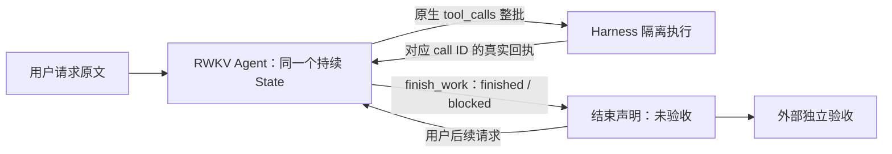

# 当前架构：单一模型 RWKV 编码 Agent

产品只有一条执行链：**一个 RWKV 模型、一个持续 State、一个循环**。用户的消息是唯一的任务文本；模型自主选择工具、读取文件、实现、自测、修复，并在完成当前请求时以 `finish_work` 声明结束。用户的后续消息在同一会话、同一 State、同一工作区中继续，不重置、不重新委派、不拼接旧请求。

推理时不存在第二个模型：没有 Planner、工单、目标包装或宿主报告。允许的额外模型调用只能是同一 RWKV 采用不同推理配置的调用，且必须先经测量再加入；当前只有一种配置（受 grammar 约束的行动轮）。Qwen 等外部模型只在离线数据引擎中担任出题与纠错教师，不参与推理（见末节）。

当前 RWKV 没有视觉能力。浏览器操作、截图和视觉检查由独立验收器在执行链外完成。模型声明、执行事实和外部验收分别记录；工程检查不产生 Agent 能力结论。

> 架构在 2026-11-02 由 Planner + Executor 工单循环切换为单一模型 Agent。旧架构保留在本地 tag/分支 `archive/planner-executor-20261102`（提交 86942d07e），不保留兼容入口；旧协议的账本、State、数据与部署登记一律拒绝加载。

## 循环与持续 State



1. 会话创建时，账本记录工作区身份、会话权限和用户首个请求；模型输入为一个 system 轮（规则、权限、工具目录）加上对话。
2. 每个模型轮：宿主只渲染 State 尚未消费的后缀（上一已提交边界之后的新消息加 `### Assistant` 头），模型生成 `<think>`、可选叙述、一个或多个工具调用，以 EOS 结束。
3. 整批调用先全部验证，再按顺序在隔离副本中执行；每个回执作为对应 call ID 的 tool 轮写回对话。
4. `finish_work` 必须是该轮最后一个调用；其参数作为模型自己的声明（`authority=agent_claim`）记录，回执与状态变更在同一账本事件中提交。
5. 用户发送后续请求（`continue_project`）时，对话追加一个 User 轮，State 从已提交边界继续。预算可在后续请求时增加，只增不减。

宿主从不判断正确性、不改写模型输出、不写任务文本。宿主需要告诉模型的事实（协议拒绝、输出截断、后台作业被回收）作为 **宿主通知** 进入对话：User 轮，内容为带 `host_notice` 字段的紧凑 JSON。账本把用户请求与宿主通知分开记录。

## 模块

CLI、批量任务、终端和 Web 统一进入 `project_agent`：`run_project_job()` 新建会话，`continue_project()` 发送后续请求，`resume_project()` 恢复未结束的当前请求。

|职责|实现|边界|
|---|---|---|
|Agent 协议（唯一输入构造器）|`project_protocols/agent.py`|system 轮（规则 + 权限 + 工具目录）、用户请求原文、宿主通知、`finish_work` 定义、输入校验；生产、trace 重建、数据与评测共用|
|运行循环|`project_runtime.py`|请求/消费、整批预校验、工具事务、权限、后台作业、停止边界；不做在线验收|
|会话账本|`project_ledger.py`、`project_record_store.py`|单写者 SQLite 事件链、内容寻址；请求列表、对话、pending、证据；权限与会话身份不可变|
|Native State 端口|`project_sessions.py`|State 引导/增量追加/生成/提交/回滚；checkpoint 身份绑定；输入容量预检|
|入口|`project_agent.py`、`agent_jobs.py`、`agent_batch.py`、`scripts/run_rwkv_agent.py`、`terminal.py`、`web_ui.py`/`web_worker.py`|新会话、后续请求、恢复、批量、交互终端、Web|
|工具词表|`transcript/tools.py`|固定九工具；规范名与底层参数映射|
|模型可见文本|`transcript/wire.py`、`grammar.py`|唯一的结构→文本转换；生产、trace、token 化与 grammar 共用|
|存储消息与回执|`transcript/render.py`、`parse.py`|原生消息形状；不生成模型可见文本|
|完整 token 与监督|`transcript/tokenize.py`、`frozen.py`、`dataset.py`|无损 token/mask；训练来源必须是当前单 Agent 对话|
|Trace 重建|`project_trace.py::agent_boundaries`|逐边界证明记录输入等于生产构造器输出|
|生成快照|`project_generation_snapshots.py`|可选：每次模型请求前封存工作区，供数据引擎分支恢复|
|工具实现|`harness.py`、`project_tools.py`、`background_jobs.py`|同一 schema 驱动执行、能力与解码|
|外部预览与检查|`project_launch.py`、`project_browser.py`、`benchmark_verifier.py`|隔离启动与独立证据；不进入 RWKV 工具菜单|

协议版本以模块常量为准：Agent 输入 `rwkv-lh.coder.agent-input.v1`、动作 `rwkv-lh.coder.agent-actions.v1`、账本 `rwkv-lh.coder.ledger.v3`、架构 `rwkv-lh.coder.architecture.v3`、模型可见 transcript `rwkv-lh.coder.transcript.v4`、存储消息 `rwkv-lh.coder.native-messages.v1`。attestation 引用常量，不硬编码版本；旧版和未知版拒绝。

## 模型输入

```
### System
<RULES>
Permissions: {"writable":[...],"protected":[...]}
Tools:
<冻结九工具目录 JSON>
### User
<用户请求原文，逐字>
### Assistant
<think>…</think> 叙述 <tool_call>…</tool_call> … EOS
### Tool Output
…
### User
<后续请求原文>
…
```

- `RULES` 定义于 `agent.py`：Agent 身份、用户请求按顺序且后续请求延续同一工作、写入权限、回执是事实而非验收、整批验证、`finish_work` 最后调用且只是声明、宿主通知格式、输出布局。`instruction_digest` 绑定其 SHA；改写规则即改变协议，旧 checkpoint 拒绝导入。
- 权限是会话配置，只在 system 轮出现一次，由宿主强制执行；不在每轮重复，也不披露剩余预算（预算由宿主执行，不作为模型输入）。
- 用户轮只含用户原文。Web 表单的"补充要求"是用户自己写的文字，按用户原文拼入请求。

## 原生 transcript 与九工具

存储为原生 assistant 消息（`role/content/reasoning_content/tool_calls`，`function.arguments` 为 JSON 字符串）。模型可见文本只由 `wire.py` 一次转换：角色头为 `### System/User/Assistant/Tool Output`，宿主追加 `### Assistant`，模型只生成正文——`<think>` 推理、可选简短叙述、随后一个或多个 Qwen3-Coder 标签调用（`<tool_call>`/`<function=NAME>`/`<parameter=KEY>`），最后是 EOS（token 0）。字符串参数原文写出，不做 JSON 转义；其他类型为紧凑 JSON；参数按 schema 顺序。每轮至少一个调用，没有纯文本轮。call ID 由宿主按对话位置分配，不进入模型文本。接受的输出必须满足 `render_body(parse_assistant(raw)) == raw`。

**EOS 规则（transcript v3 起）**：每个 assistant 正文以一个受监督的 EOS 结束；grammar 只允许以 EOS 结束一轮；解码策略 `terminal_eos_enters_state` 让 EOS 进入持续 State，因此宿主下一个角色头在训练和服务中跟在同样的字节之后。冻结训练行必须让每个监督段恰好以一个 EOS 收尾。

|规范名|作用|
|---|---|
|`Read`|按字节范围读取文件|
|`Write`|写入文件|
|`Edit`|按精确文本匹配替换|
|`Bash`|执行命令，可显式后台运行|
|`ListDir`|枚举目录|
|`Grep`|有界搜索与分页|
|`BashOutput`|读取后台作业新增输出|
|`KillShell`|停止本会话后台作业并报告观测结果|
|`finish_work`|以 `finished` 或 `blocked` 和给用户的总结结束当前请求|

工具回执是对应原始 `tool_call_id` 的 tool 轮，content 为结构化 JSON（`action_type/success/output/metadata/...`）。`finish_work` 的回执只携带 `declaration` 原参数。文件正文、命令输出和错误保持原文；完整原始回执另存于 `raw_tools/` 供身份核验。宿主通知只能是 User 轮，不能伪造模型未发起的 tool 回执。

约束解码由 irwkv 内置 guidance 执行；grammar 从 `wire.py` 的标签与同一工具 schema 派生，保留 `additionalProperties:false` 与键序。完整消息结构、跨轮 call ID 唯一性与参数仍由宿主校验。

## 权限、后台作业与恢复

工作区是经身份核对的源目录副本。会话权限 `writable`（默认 `["."]`，即整个工作区）与 `protected` 为字面路径集合；`writable=[]` 为只读会话。`file` 与 `./file`、`.` 与 `./` 按相同 POSIX 身份比较，保留原拼写，不猜路径、不展开通配符；绝对路径、`..`、反斜杠与 NUL 拒绝。权限在会话创建后不可变（账本拒绝修改）。

前台工具在隔离副本执行。显式越权写入在执行前拒绝；执行后整体变化越权则全部不发布。合法变化经身份核对后原子发布（`renameat2` 交换）。相对符号链接必须逐段留在工作区内；链接不扩大权限，保护路径同时保护真实目标与中间链接。无效链接与特殊节点不发布。

`Bash` 使用共享宿主网络（不是域名白名单）；文件、PID 与其他命名空间隔离，只继承明确的基础环境和普通 HTTP/HTTPS 代理。网络外部效果不能由文件事务回滚，未知结果不重放。后台模式保留独立沙箱与私有工作区，返回 job handle；活跃期间不发布异步写入，确认停止后复核启动基线、权限与保护路径才发布。运行器退出时（包括 checkpoint yield）确认回收所有作业，丢弃未提交的私有变化，并以宿主通知 `background_jobs_reclaimed` 告知模型。不能确认清理时抛出 `UncertainToolOutcome`，保留 pending。

模型与工具先登记 intent、再确认返回。已确认写入与已确认批次前缀不重复执行；失联、取消、发布或清理结果不确定时保留 pending，恢复不自动重放未知操作，也不能在 pending 存在时接受后续请求。

## 停止边界与结果

|原因|含义|会话状态|
|---|---|---|
|`model_finished`|模型调用 `finish_work`（`finished` 或 `blocked`）|`finished` / `blocked`，可接后续请求|
|`resource_budget_exhausted`|总调用预算用尽|`interrupted`，后续请求可追加预算|
|`wall_budget_exhausted`|墙钟预算用尽|干净边界时 `interrupted`|
|`model_output_budget_exhausted`|单轮输出截断；截断轮回滚、不执行，并写入宿主通知 `turn_truncated`|`interrupted`|
|`model_input_budget_exhausted`|输入超出容量；保存完整输入与容量证据，不截断|`interrupted`|
|`repeated_rejection`|连续协议拒绝达到 `rejection_limit`（默认 3；有效轮清零）|`interrupted`|
|`checkpoint_yield`|调用方 `max_turns` 让出|`running`，可 `resume`|
|`execution_error`|宿主异常；已确认前缀保留|`running`，可 `resume`|
|`uncertain_operation`|未知结果的操作|`running` + pending，需人工核对|

`interrupted` 只在干净边界设置（无 pending、无未消费输出）；中断与对应宿主通知是同一账本事件。中断不是完成。

`RESULT.json` / `DELIVERY.json` 字段：`architecture`、`session_id`、`status`、`termination_reason`、`termination`（`agent_finished` / `budget` / `stopped`）、`final`、`final_claim`、`model_finished`、`completed=false`、`acceptance=not_evaluated`、`model_calls`、`agent_usage`（调用数、生成耗时；无真实 token 计量时为 `null`，不估算）、`request_count`、`requests`（每个请求的原文、调用数、回执 ID、声明、终止原因）、`mutation_count`（只统计真实已提交变更）、`changed_files`、`final_tree`、`diagnostics`（`resumable`、pending、错误、拒绝记录、回收的后台作业）。CLI 退出码 0 仅对应 `agent_finished`，不证明功能验收。

执行目录保留 `project.sqlite3`、`model_trace.jsonl`、`raw_tools/`、`tool_transactions/`、`PROGRESS.jsonl`、`RESULT.json`，外层 `DELIVERY.json`；启用选项后保存 `generation_snapshots/`。终端会话每轮后续请求前把上一份 `DELIVERY.json` 归档到 `deliveries/turn-NNN.json`。

## 外部验收

外部静态或 npm 预览在隔离副本启动，不调用模型，也不改变完成声明。独立浏览器检查使用新 Chromium 上下文和只读工作区，保存逐动作状态、DOM/布局、截图、HAR、trace、console 与网络事实；独立验证器保存完整输出、退出状态与证据 SHA。私有检查与期望输出不进入模型工作区、工具回执或 State，不授予训练资格。Agent 级评测先报告 Strict、completed、mutation 与终止原因，再报告工程检查；未运行写"未运行"。

## 训练、推理与来源身份

训练统一使用固定版本 skyrl-rwkv 原生 `skyrl.train.main_sft`；登记方法 `sft_full`（`model.lora.rank=0`）或 `sft_nora`（NoRA，登记 `lora_rank`/`lora_alpha`，不可与 CPU offload 同用）。本仓库只核验冻结模型、tokenizer、数据、源码、授权、预算和 GPU 身份并交接；优化器、checkpoint、恢复与导出归 SkyRL。

训练 reader 只接受 `transcript_tokens` 与 `rwkv-lh.transcript-token-manifest.v1`，manifest 的 `input_protocol` 必须等于当前 transcript 协议（v4）。每个来源必须是当前单 Agent 对话：首轮是当前 `agent.py` 构造器对该工具目录输出的 system 轮（权限从中解析并复核），随后第一轮是用户请求；任何其他 system 轮（包括旧工单 Executor）拒绝，不改写。逐行复核完整 `input_ids` 与 `loss_mask` 和共享 codec 一致：assistant 正文与其 EOS 监督为 1，角色头与 system/user/tool 为 0；不位移、不截断，容量不足直接拒绝。行准入需要外部验收证据（`validate_row_acceptance`）。新数据版本与训练预算必须由 owner 明确授权。

训练与推理均为 BF16 权重/计算；递归 State 中 wkv 为 FP32、两个 token-shift 池为 BF16，两种运行分别登记，不笼统写作 State FP32。推理统一使用 irwkv `irwkv-native` profile：单卡 TP/PP=1、`max_num_seqs=1`、关闭 prefix caching、`mamba_cache_mode=none`；插件 `rwkv_lh_state_worker,rwkv_lh_native` 负责跨请求 State、事务、请求日志与身份。部署登记 `rwkv-lh.irwkv-deployment.v1` 要求 `protocol="agent"`；旧 `executor` 登记拒绝。transcript 协议改变会改变 decoder 合同 SHA，部署须用当前源码重新上传与核验。服务器禁用 Git，只上传带逐文件 SHA 与清单 SHA 的完整清单。

模型为标准 Transformers-RWKV safetensors。RWKV 端点配置沿用环境变量前缀 `RWKV_LH_EXECUTOR_*` 与 `RWKV_LH_PROJECT_EXECUTOR_*`（部署配置名，保持稳定；"executor" 在此只指 RWKV 推理端点）。

## 数据引擎（离线，教师模型只在此处）

训练数据来自 RWKV 优先的循环，位于 `rwkv_lh/data_engine/`（由 Codex 实现，合同见本地 `data/experiments/ROUND_01/SINGLE_MODEL_AGENT_20261102/CODEX_BRIEF.md`）：

1. 出题：Qwen 高并发生成用户请求、种子工作区、隐藏检查、参考解与变异体；只有参考解全过、每个变异体至少失败一项的任务才准入。
2. RWKV 执行：调用本节之上的生产单 Agent 循环（不重写 Agent、工具、wire 或 codec），开启 `record_generation_snapshots` 保存每步工作区。
3. 验证：隐藏检查与轮级事实（解析失败、截断、未结束、重复失败调用、声明与执行不符）。
4. 纠错：Qwen 只看 RWKV 实际看到的内容和失败标签名，给出第一个错误轮 k、错误类别与 n 个候选替换轮；候选必须通过生产解析器逐字节往返。
5. 分支继续：恢复第 k 步快照，真实执行替换轮，RWKV 从修正后的 State 继续，最终再验证。
6. 构建：只经生产 codec 构建样本（`frozen.training_messages` 校验来源为当前单 Agent 对话），导出布局与 `transcript/dataset.py` 的输入一致。

准入只取决于执行与隐藏检查，不取决于任何模型的判断。教师模型永远不在推理链中。

## 维护与发布

开发题、验收轨迹、私有参考与 Holdout 不进入训练；Real Agent Holdout V2、`acceptance_tests/` 与 `data/acceptance/` 不在日常回归、迁移或清理范围。工程回归、GPU 推理、实际 optimizer 更新和 Agent 验收分别报告。GitHub 只发布 README、本架构、维护中的源码与必要构建配置；tests、acceptance_tests、benchmarks、data、temp、AGENTS 与其他文档仅本地维护。清理先登记路径与逐文件 SHA；完整本地回归不得跳过 Torch、State 注入或必需浏览器测试；同轮全绿后本地提交，owner 负责 push。
