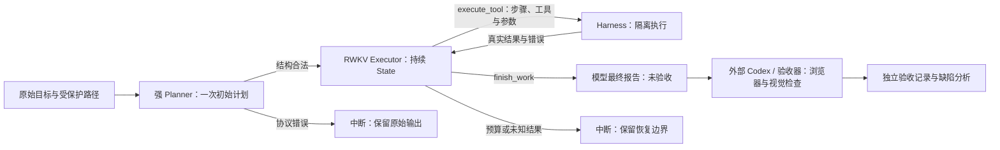

# 当前编码项目架构

当前产品面向前端项目完整交付，采用一份初始强模型计划与一个持续 State 的 RWKV Executor。Executor 负责创建项目、生成和修改代码、执行命令、根据实际报错修复、测试、构建及交付，自主选择步骤、工具和结束时机。当前 RWKV 没有视觉能力；浏览器操作、截图、视觉检查和浏览器端诊断由 Codex 或独立验收器在执行链外负责。项目整体仍须满足需求、视觉、功能、工程、数据和交付要求；实际能力由冻结项目的独立验收与预定重复运行证明。

产品仅有这一条链路。Decision、在线计划审查、阶段审查、重新规划、诊断求助及独立完成验收已移除；没有开关、旧协议兼容模块或自动回退。

## 执行流程

初始 Planner 只允许 `submit_plan`，收到原始请求、workspace 清单、请求明确引用的已有文件材料、保护路径、剩余预算与实际注册的 Executor 能力摘要。能力从同一前端工具合同按文件、命令、网络和数据边界生成，浏览器检查不进入 Planner 能力或 Executor 菜单。能力摘要随原始输入保存，Trace 重建复用原记录，不读取已变化的工具注册表；它说明可用操作，不宣称某次运行或行为检查已经成功。

模型可见输入区分空工作区与未知工作区，省略协议身份、空计划/反馈及目录权限数值，预算时间显示为整数秒；完整内部身份仍保留。材料入口按实际相对路径匹配，不特判文件名或扩展名；完整 UTF-8 正文、字节数与 SHA 和初始工作区身份绑定，非 UTF-8 文件明确标注而不伪造文本。材料捕获前后及逐文件身份均核对，发现变化即拒绝；这不是对任意外部写者的原子文件系统快照。未引用的源码与间接引用仍由计划中的调查步骤交给 Executor 读取；不要求执行证据先于执行。阶段与步骤数量按任务需要决定，没有固定数量上限或静默截断。需求忠实于用户请求，实现选择放在任务中；任务字段明确唯一标识、引用和无环依赖，以及可观察的预期交付或行为检查。每个任务必有 `checks`：在工作区根目录用 `run_shell` 运行的字面命令列表，退出码 0 表示实现后的预期行为；无命令检查时为空数组。宿主从不运行或评判这些命令，由 Executor 决定是否、何时运行。

宿主校验字段、唯一标识、需求引用、依赖结构与路径权限，不评价计划是否正确合理。不合规的初始返回结束为 `planner_protocol_error`，同一任务恢复时不会重新调用 Planner。

项目创建时，账本冻结初始 workspace 身份与请求明确引用的完整材料；Planner 和 Executor 共用这份原始上下文。计划安装后，宿主建立一个覆盖原目标的稳定 Executor lane，完整计划及原始引用材料送入首次输入。材料摘要绑定 assignment，正文、字节数、SHA 和 non_utf8 状态保持原样；Executor 不重复接收整个仓库清单。后续工具修改、恢复和 Trace 重建均不会用新文件内容覆盖原始材料，Native 增量不重复追加未变化正文。每次工作区工具调用都由模型显式给出 `step_id`；工具 intent 与这次选择在同一事务持久化，权限和回执绑定该步骤。切换步骤不会更换 lane、重新委派或清空 State。依赖描述计划顺序，不构成已验证依赖门；模型可以选择和重访任意已声明步骤。

## 唯一入口与模块职责

CLI、批量 coding 和 Web 统一调用 `project_agent.run_project_job()`，恢复入口为 `resume_project()`。`CodingJob` 只保留请求、workspace、总调用/时间预算、保护路径和生成快照选项。没有单元交回预算或可选初始规划参数。

|职责|唯一实现|边界|
|---|---|---|
|原目标与计划合同|`project_contracts.py`|结构、引用、路径与身份；不作语义验收|
|持久记录|`project_ledger.py`|单写者、事务、事件链、原始回执、动作步骤、结束声明与未决操作|
|初始材料|`project_materials.py`|完整捕获被请求引用的文件；不解释需求或授予写权限|
|初始 Planner|`project_protocols/planner.py::build_input`|一次规划；不执行工作区工具|
|自主 Executor|`project_protocols/executor.py::build_input`|原始目标、完整引用材料和计划、最近工具步骤、工具事实、回执与预算|
|动作合同|`project_protocols/executor.py::action_definitions`|执行工具、读取回执、结束；步骤与原始工具参数分离|
|输入呈现|`project_markdown.py`、`project_model_io.py`|Markdown 工具目录、目标、计划、反馈和原始材料；唯一 bootstrap 与增量 renderer|
|State 与实际传输|`project_sessions.py`|Native 增量、干净重试锚点、模型/协议/工具/采样身份绑定|
|运行器|`project_runtime.py`|执行合法模型操作、落实权限、提交真实事实与预算中断|
|Trace 重建|`project_trace.py::role_boundaries`|全链验真后调用当前生产 builder；不授予训练资格|
|工具合同|`harness.py::ActionDefinition`|菜单、schema、权限、回执与 decoder 共用定义|
|前端工具装配|`project_tools.py`|默认六项文件/命令工具；生产、Planner 能力、decoder 与离线入口共用|
|外部预览与检查|`project_launch.py`、`project_browser.py`|由外部调用的隔离启动、HTTP 与浏览器检查；不属于 RWKV 工具|

当前版本：整套 Project 协议是 `rwkv-lh.coder.*` 命名空间的第一版——Goal、Plan、Assignment、Ledger、Executor 输入、动作、Planner 输入、Planner chat、prompt、输入传输、边界解码、JSON fence、严格调用、架构身份、强模型传输和模型视图均为 `.v1`。新命名空间不与任何历史标识重名（旧 `rwkv-lh.project-*.v1`、`project-*.v1`、`rwkv-lh.agent-*.v1` 都曾存在），因此旧协议、账本、prompt 和不兼容 State 仍一律拒绝恢复或改标签重用。运行标签引用模块常量。数据与冻结证据的标识（候选、固定回归、冻结证明、审查包、生产来源、训练行）标记已封存的原件，不随运行协议改名。

工具目录与被拒调用视图只渲染决策信息：工具名、说明、参数名、是否必填、默认值、`const`/`enum` 选项。类型、长度、正则、上下界、`additionalProperties`、`uniqueItems` 由约束解码器从同一 schema 强制，不进入模型输入；固定值的可选参数不展示；`anyOf` 各形式共享的字段只出现一次。未知 schema 键直接报错，不得静默消失。

底层只读工具与独立研究依赖不构成另一条编码产品入口。模型升级通过权重、tokenizer、State、上下文和传输配置适配，不自动改变角色协议。

## Executor 操作与反馈

Executor 只产生一个严格的 `function/params` JSON 对象。动作参数为：

|动作|参数|效果|
|---|---|---|
|`execute_tool`|`step_id`、`tool`、`arguments`|在一次调用中选择计划步骤和工具；arguments 只含 Harness 原始工具参数|
|`read_receipt`|`receipt_id`|重新投递已有回执原文，不重新执行工具|
|`finish_work`|`outcome`、`summary`、`receipt_ids`|outcome 为 finished 或 blocked，保存模型原文并结束|

默认工作区工具只有 `list_directory`、`search_files`、`read_file`、`write_file`、`replace_text`、`run_shell`。重复文件操作和丢弃写入的 `check_command` 不进入产品菜单。`project_tools.configure_project_tools` 同时限制 schema、执行和恢复注册表；显式注册的外部 `check_project` 及同类检查能力也被排除，不能借扩展重新进入 Planner 或 RWKV。共享研究 Harness 保留自身工具合同。

产品 `replace_text` 仅接收路径、旧文本、新文本及匹配次数/全量替换选项，不接受模型填写文件 SHA 或其他版本令牌。它与研究 Harness 复用同一个文本替换实现；产品配置以精确内容匹配和现有隔离事务执行，缺失或歧义匹配返回真实失败且不写入。修改不声明幂等，未知执行结果不得自动重放。多任务并发应使用各自工作区，已确认写入的发布及恢复仍由工程事务负责，不由模型维护校验值。

`project_tool_feedback.model_tool_result` 是 RWKV 提示和教师采集共用的模型可见回执视图。文件内容、命令输出和真实错误保持原文；文件哈希、修改版本校验、命令流摘要等工程元数据不展示：读取游标块（已由 start/end/next_start_byte 与行范围表达）、未改变解析的 shell 包装 argv、零字节 stdin、只读工具的 `workspace_committed=false` 及空值字段均省略；`false`/`0` 等实际取值保留。来源段只在模型给出的参数值与实际执行值不同时出现，Harness 补充的默认值本身已在执行参数中。搜索结果只移除工具产生的摘要字段，实际命中文本、位置和分页游标保留。原始完整回执仍用于内部来源核验，不能直接重写成新模型实际收到的历史；旧 prompt/工具身份不得作为新格式恢复或重标。

例如 `{"function":"execute_tool","params":{"step_id":"T2","tool":"read_file","arguments":{"path":"README.md"}}}`。旧工具直接调用、独立选步、步骤汇报、双绑定方式及兼容入口已删除。缺少步骤、未知工具、错误参数或多余字段一律拒绝，宿主不补齐、不丢弃字段。模型可以在没有自测或完成全部步骤时结束；finished 只代表模型声明。

约束解码仍在生成时使用 guidance。schema 精确绑定全部合法步骤、各工具的参数变体、现有回执和结束枚举；必填字段不会延迟到生成后再补。schema 唯一推迟的是数组 uniqueItems 校验，宿主仍验证重复引用。非法回执不产生工具执行。强 Planner 使用当前 `rwkv-lh.coder.strong-strict-tools.v1` 传输：唯一操作通过具名 tool_choice 指定，API arguments 直接包含该工具参数，不再套额外 params。原始 arguments 字符串逐字保留，由唯一角色 parser 校验；旧包装、模型自创别名、裸计划、额外身份和转义修复均不接受。传输格式通过不等于计划正确。

模型的目标、计划、工具名字/描述/参数合同、事实反馈和预算统一渲染为 Markdown。实际源码、工具正文及拒绝原文按字面保留；其中本来就有的 JSON 不改写。内部输入对象用于哈希与审计，不直接序列化为 RWKV 决策提示。Native 初始输入、增量、容量检查和离线 token 回放调用同一 renderer。模型视图省略 assignment 中重复的请求和工程身份、原始模型 OP、重复参数与空输出段；引用材料和工具字面内容保持完整。稀疏显示的旧步骤与引用来自经 base_digest 核验的 view_base，拒绝重试使用同一干净锚点；原始角色 payload 不因渲染压缩而裁剪。`rwkv-lh.coder.model-view.v1` 同时绑定 prompt 身份和输入恢复封装；缺失或旧视图身份拒绝恢复和 token 重放。

步骤观察只记录工具次数、失败、实际提交变更、路径、回执与最近工具步骤，不维护独立的“完成步骤”声明。计划检查只按事实投影：命令字面相同且 cwd 为工作区根的已确认 `run_shell` 回执计为一次运行，显示运行次数、最近一次退出码与成功位、对应回执，以及之后是否有已提交的工作区变更（结果可能已过期）；未运行的检查只在计划中出现。相似但不同的命令不计入，不构成完成门、不触发自动执行。完整账本保留全部步骤和回执；模型视图只显示有调用或当前选中的步骤，后续按 step_id 更新实际变化的行。回执清单在模型视图中合并，后续只给出新增或移除的句柄，约束解码器仍校验完整合法集合。工具实际参数默认值由 Harness 合同处理，模型原始 arguments 与执行后的 arguments 分别记录，防止混淆。

最新工具原始结果自动送达。回执按确认顺序提供 `receipt:N`，只在有类型的引用参数位置转换为原 OP；文件、工具内容与报告正文保持字面值。每次显式读取都有可见投递 revision、显式读取次数和内容未变事实，同样的完整正文也会再次进入增量。工具重复事实由已确认账本推导，按实际默认值归一后的工具参数统计调用数、相同模型可见结果数和连续相同结果数；正文、错误、退出码和变更事实的变化均参与比较。重复事实不选步、不修改完成条件或提前中断。游标只确认实际输入包含的投递事件；无变化的旧工具正文不因无关后续动作而重复追加。

非法输出保留原文、错误、实际参数合同和连续拒绝事实，回到同一 Executor。拒绝生成不会提交其候选 State；干净锚点中的已确认事实保留。新工具事实或步骤变化推进正常父 State 链。Controller 不替模型选择修复、不补语义参数、不引入额外模型。

## 权限、事务与中断

工作区来自经身份核对的源目录副本。写入权限为该次工具明确选择步骤的显式范围，并叠加 owner 与初始计划的保护路径。禁止写入、路径逃逸及未知操作结果仍由宿主阻止，这些是执行边界，不是模型正确性检查。

任务 `scope` 是字面写入路径集合：空数组表示只读，可读取材料但不能提交任何文件变更。字段缺失仍属协议错误。路径采用工作区相对路径规则，`file` 与 `./file`、`.` 与 `./` 权限相同；保留模型和 owner 的原始拼写，按 POSIX 路径身份比较保护范围，不猜测文件、不展开通配符。绝对路径、`..` 路径分量、反斜杠与 NUL 一律拒绝。Planner schema、计划验证、计划安装与执行权限遵循同一语义；旧计划不通过自动补字段或改路径迁移。

工具在隔离副本执行。显式越权写入在执行前拒绝；命令运行后的整体变更若越权，全部不发布。合法变更以完整事务发布，`run_shell` 构建产物可供后续操作读取。失败和无变化分别保留原始回执，不产生假 mutation。命令没有跨调用持久后台服务保证；项目运行和命令诊断由模型在命令生命周期内完成。

前端 `run_shell` 的注册合同声明 public_web，执行时使用共享宿主网络，供依赖下载和服务访问；这不是域名白名单。网络模式由同一个 ActionDefinition 驱动执行、Planner 能力摘要、Executor 目录和回执，不依赖模型自行打开宿主开关。底层研究 Harness 的命令默认仍隔离网络。裸命令名按沙箱实际挂载的系统及已声明 Python/venv 工具链解析，不受交互终端用户目录中同名程序遮蔽；明确绝对路径仍受范围检查。缺失路径提示枚举前验证符号链接父目录仍位于工作区。文件、PID 与其他命名空间继续隔离，WSL 仅额外挂载解析后的 DNS 文件；命令环境只继承明确的基础字段和普通 HTTP/HTTPS 代理地址，不继承宿主凭据及用户 npm 配置。npm 使用临时缓存；工具显式 env 可以覆盖默认值。网络请求的外部效果不能由工作区文件事务回滚，未知结果不自动重放。

命令超时和项目取消时，先终止本次进程组并收完剩余输出，等待沙箱 reaper 与子进程关闭输出管道，再返回或传播取消；无法在清理期限内确认时抛出 UncertainToolOutcome。Harness 不把它转成普通失败回执，Project 保留 pending 事务、不发布工作区、不自动重放。开始监听的输出仍可保留为诊断事实，不能因为日志显示 ready 就宣称服务在后续调用中持续存在。

工作区支持能随副本迁移的相对符号链接：每段解析均留在工作区内，最终目标存在，且没有解析循环。npm 的命令入口、项目内本地包、文件和目录别名遵循同一规则，没有 node_modules 或题目特判。绝对链接、越界、悬空和循环链接以及特殊节点不发布；绝对链接即使指向原目录内部，也不能在目录复制及事务交换后维持相同目标。身份记录保留链接目标的原始拼写，并分别绑定实际文件 SHA；复制、材料捕获、生成前快照、来源封存、离线纠正及外部验收共用这一身份规则，不展开目录别名树。写权限仍按实际变更路径检查，链接不能授予新范围；受保护路径同时保护实际目标及到达它的中间链接。

越界写入被拒绝时，模型视图中的路径列表有上限：不超过 20 条时原样列出；超过后按顶层路径段汇总为 `段/** (N paths)`，并最多保留 20 组。原始回执正文同样会投递给 Executor，所以它也只带同一份摘要、`scope_violation_count` 和最多 20 条 `workspace_entry_errors`。完整路径与条目错误写入 `tool_transactions/<id>/scope_violation_paths.json`，回执的 `scope_violation_record` 指向该文件，不进入模型输入。这样一次 npm 安装产生的上千个路径不会让下一轮输入超出 Native 单次增量上限。

外部检查器可显式注册 `check_project`，使用 `project_browser.py` 的参数合同操作真实 Chromium。它在工作区外保留逐动作状态、DOM/布局、截图、HAR、trace、console/pageerror 和网络事实及 SHA；失败或超时保留证据并清理进程。检查使用只读项目副本和新浏览器上下文，只允许本次项目源的 HTTP/WebSocket 请求。外部结果不自动进入 RWKV 回执、State 或完成声明；无浏览器动作时仅验证 HTTP readiness。外部 npm 预览按项目声明的 `dev` 或 `build`/`preview` 脚本启动，生产预览要求 `dist/index.html`，不再要求 Vite 依赖。

SQLite 事件与内容寻址记录保留输入、输出、checkpoint、原始回执和因果身份。模型/工具调用先登记 intent，再确认返回。失联、取消或发布结果不确定时保留 pending，不自动重放。断点恢复保留总预算、lane 和已确认 inbox；已完成的写入不重复执行。服务不再持有必要 Native State 时不得假装恢复。

内容记录在每个 RecordStore 内按 64 MiB 字节预算复用已校验节点，避免共享历史超过固定节点数量后反复读取与验真。预算计算节点对象、键与条目开销，超大节点不缓存；它不限制 SQLite 缓冲区、返回的完整历史或进程总内存。展开后的可变结果不共享，新读取事务重新校验，事件链检查仍覆盖全部历史；缓存不改变存储格式、模型输入或事实权限。

初始材料随账本创建持久化，直接安装离线冻结计划也经过同一捕获入口；Trace 通过唯一 builder 从原始上下文重建并核对身份，不重读已变化的工作区。引用集合由初始清单校验，Executor 的材料视图由稳定 assignment 摘要绑定；未引用、间接引用及私有内容不会被自动注入。输入超出部署容量时记录完整输入与估算，按中断处理，不截断计划或材料。总预算耗尽、输出预算耗尽和超时均不能伪装成完成。

## 可观察输出与结果语义

执行目录保留：

- `project.sqlite3`：可验真的完整事件链与模型输入/输出。
- `model_trace.jsonl`、Strong trace：实际传输、采样与原始返回。
- `raw_tools/`：完整工具结果。
- `PROGRESS.jsonl`：逐次模型命令、步骤、反馈和对应真实工具正文的可读投影；SQLite 为权威记录。
- `RESULT.json` 与外层 `DELIVERY.json`：最终状态、终止原因、模型报告、步骤事实和 mutation。
- 开启选项时的 `generation_snapshots/`：每次生成前实际 workspace 的身份与快照。

`status=finished` 与 `model_finished=true` 表示模型选择结束。当前执行流程始终保持 `completed=false`、`acceptance=not_evaluated`；外层超时可能标记不可评估。退出码 0 只表示模型正常结束并返回报告，不表示功能验收成功。Web 显示有执行记录的步骤、真实工具回执和最终模型声明，不能用绿灯或“已验证”代替真实验收。

真实开发评测的 Strict、功能完成与 mutation 必须在独立结果中报告。后续独立验收不能回写这次运行的模型报告、冻结源码或评分口径。

Web 增量轮询绑定每次项目选择的独立身份，同一选择只保留一批在途请求，待所有接口响应或失败后才释放。事件和 trace 游标只向前推进；离开、切换或重新选择同一项目后，旧响应、错误和计时器都不能更新当前选择。文件预览另按当前项目、文件路径与请求编号核对归属。这些机制保护证据的展示，不改变原始记录、模型行为或验收结果。

独立项目检查 `benchmark_verifier.run_isolated_verifier()` 可显式接收工作区外的新 `evidence_dir`，为每个检查保存完整 stdout/stderr 和私有程序写入 `RWKV_LH_VERIFIER_EVIDENCE` 的截图、HAR、浏览器 trace 等文件。内层检查超时返回失败与实际退出状态；外层验收中断保留不完整证据，不宣称通过。回执中的文本预览仍有明确截断标记，完整文件按检查序号分开保存。

证据清单绑定实际只读工作区树（含原始链接目标和逐文件 SHA）、快照实现 SHA、验收输入摘要、验证器源码 SHA 和每份证据 SHA/字节数，清单自身 SHA 在结果中返回。候选工作区可包含上述有效链接；证据输出目录自身仍拒绝覆盖、工作区重叠、链接和特殊文件。候选 Python 子进程的独立 namespace 隐藏私有程序和证据目录，并移除证据环境变量。证据只供运行后的独立复核，不送回 Controller、改变模型完成声明或授予训练资格。截图存在本身不能证明视觉要求通过。

前端评测来源先核对固定版本与许可证，再实际验证上游项目的资源、安装、构建、浏览器行为和数据流。教学示例的缺失功能与依赖须明确记录；派生参考版本要单独绑定改动与验证，不能把它的通过写成上游通过。需求和允许素材与完整答案、私有验收分离，所有必需要求逐项验收；评测项目及答案不转作生产纠错训练来源。实验身份未变的有效结果复用；新增实验须说明改动或尚未解决的问题。

新任务冻结时分别写明 Agent 的创建、实现、命令运行、修复和交付要求，以及外部浏览器/视觉验收要求。已有冻结任务和成绩不原地改写；职责变更须登记新规格版本及其验收关系，不能把两种职责下的运行混为同一基线。

## 数据与后续实验

生产、trace、候选提取、StateTune 校验和角色评测共用当前输入构造与 renderer。当前只有 `project_executor` 角色数据入口；旧 Decision 数据不能重标为 Executor。

Executor 训练标签的文本就是边界解码器实际生成的文本：紧凑 JSON，键按 schema 属性顺序排列，由 `project_decoder.render_role_target` 统一渲染。标签不追加 stop 后缀；终止 EOS 由解码器强制生成，不进入 State，也不计入 loss。不符合这一形式的行在 StateTune 校验时被拒绝。

候选来源需重验事件链、生成前快照、Native 完整输入 token、父 State、原始生成与实际 decoder。离线候选审查与训练准入仍独立存在，仅用于授权后的数据工作，执行器不会调用它们。未审查轨迹、机制夹具、脚本输出和参考实现不会自动成为训练数据。

缺陷分析关联两份独立证据：RWKV 的真实创建、代码、命令和错误轨迹，以及外部浏览器/视觉检查结果。外部发现可用于定位原因和验证纠正，但不是 RWKV 当时已看到的反馈，不能倒灌进早先输入或伪装为模型动作；需要文字反馈后的真实续跑时另行披露并保留原 source_group。评测项目、私有检查和参考答案继续与训练来源隔离。

`project_correction_corpus` 将已登记 train 来源的真实边界积累为待人工分析材料；重复动作仅是诊断信号，不自动等于错误。外部作者在原始完整输入上纠正下一动作，原错误输出和来源保持不变。修正工具动作通过 `ProjectRuntime` 在生成前快照的独立副本中执行，沿用原计划范围和保护路径；账本明确标记离线作者，不伪造 RWKV 调用、State 或后继生产数据。代码修改须有能区分修改前后的实际检查，写入成功本身不足以证明修正合适。

`read_receipt` 和 `finish_work` 的离线纠正从原始生成前事件恢复当时已有的工具证据与投递状态，保留原回执身份和字节，通过明确的导入事件写入隔离账本，再调用生产回执投递或结束方法。证明绑定实际控制事件及来源文件；不得导入未来证据、伪造工具回执或模型调用。结束声明执行成功只证明该操作被记录，不能证明任务完成。

错误积累、修正执行、独立复核和训练准入各自保留结果。超长输入可完整保存和复核，训练行仍必须满足既定容量，禁止截断前文。`load_executed_candidate` 重新绑定原始输入、作者目标、实际执行账本、检查文件和独立复核，仅返回候选；正式数据冻结仍须满足去重、任务族隔离和覆盖要求。回执/结束动作同样需要独立材料复核，控制事件证明不能代替事实依据和目标合适性判断。

`project_training_windows.py` 可为已验真的 train 边界建立明确标记的离线训练窗口：复用唯一 Executor builder，保留当前目标、完整计划、工具、进度及合法引用，只调整历史动作反馈的投递范围。最近 K 份回执与作者预登记的必要更早回执均保留完整正文，未来回执不能进入窗口。窗口不声称是原始 Native 输入；分别记录原始前缀、派生输入、策略与源码摘要，并重新验证同一纠错目标的真实执行和独立材料复核。监督从窗口起点的可训练初始 State 开始，损失只计算目标；生产持续 State、固定完整前缀回归与 Agent 验收不改用窗口。窗口容量不足仍拒绝准入，不能静默截 token 或脱离证据补全事实。

离线纠错复核使用 `project_training_labels.py::build_review_input` 构造 Markdown 材料：完整原始输入只出现一次，末尾单列本次纠正目标；当前错误输出留在来源记录中，不与目标并列投递。复核通过唯一命名的严格函数 submit_correction_review 返回，生产端与验收端共用 review_tool_definitions；除来源、输入与完整目标摘要外，还必须逐字段绑定实际审查的动作、步骤与工具（或回执/结束类型）。当前复核合同将这些既定身份字段限制为单值枚举，并在材料中显式展示完整绑定对象；判词、问题列表和理由由复核模型独立给出，原始响应仍须验证，不能在返回后改写绑定或判词。最近活动步骤不构成不可回退的阶段门；旧版复核记录不能直接作为新版标签准入。

`verify_review` 对接受与拒绝判词执行相同的原始请求、响应及目标绑定验证；有效拒绝可被审计，格式或绑定错误不能冒充有效拒绝。候选加载器先由真实来源重建材料，再使用同一验证器并单独要求接受判词；审计成功、工具执行成功和作者对拒绝理由的异议均不授予准入资格。

数据去重统一使用 `project_training_freeze.py::similarity_material` 去除行首 Markdown 标题标记，再计算 UTF-8 byte 5-gram count-vector cosine（阈值 0.95）。这只影响去重视图，不改变模型收到的完整输入、训练 token 或标签；仓库族隔离仍独立强制执行。固定回归、索引和冻结证明绑定该格式归一化版本，不能把旧索引静默重算为新结果。

所有实验使用冻结源码清单与预登记预算；当前运行不依赖旧实验、旧 State 或旧调度。训练与新数据集版本另按明确授权执行。公开 CI 只验证发布源码与构建；完整工程回归和真实 Agent 成绩分别报告。新开发基准覆盖 CLI、数据、API、维护、Web 与全栈的需求阅读、实现、自测、修复与交付；题目、私有黑盒、参考实现与变异验证只在本地。新任务不等于真实用户 trace，也不自动获得训练资格。
